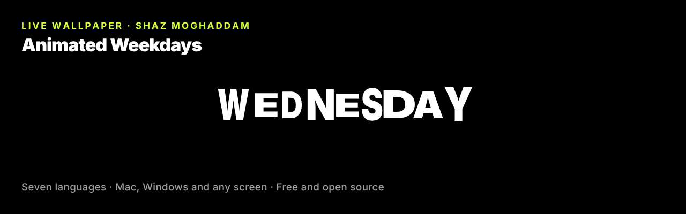
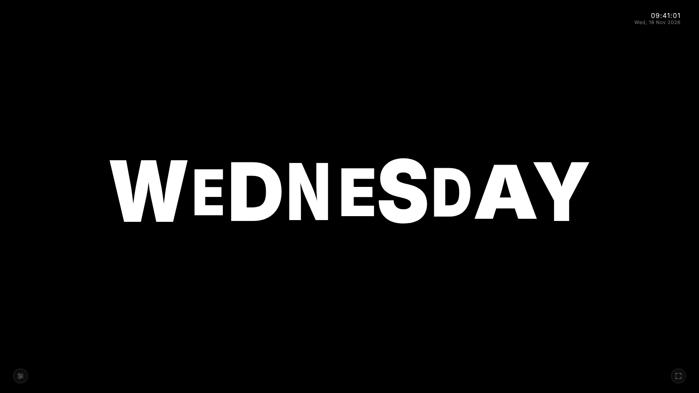
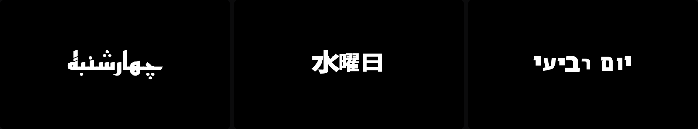
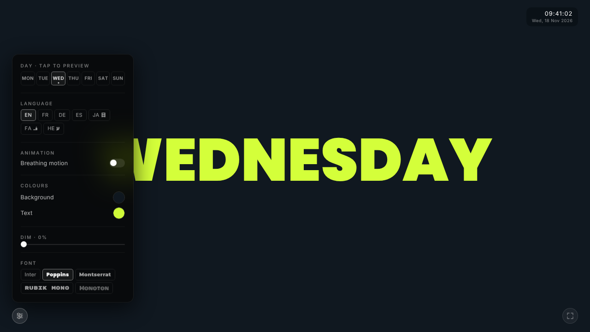

# Animated Weekdays

**The day of the week, breathing on your screen.**

[](https://github.com/ShazMoghaddam/animated-weekdays-live-wallpaper/actions/workflows/check.yml)
[](https://github.com/ShazMoghaddam/animated-weekdays-live-wallpaper/actions/workflows/pages.yml)
[](LICENSE)

Animated Weekdays is a live wallpaper that shows today's name in big, heavy letters that stretch and settle like they're breathing. Set it as your desktop wallpaper on a Mac or Windows PC, or put it full screen on any spare display. It's one web page with nothing to install, and it runs offline.

**[Open the wallpaper](https://shazmoghaddam.github.io/animated-weekdays-live-wallpaper/wallpaper/)**, or visit the [site](https://shazmoghaddam.github.io/animated-weekdays-live-wallpaper/) for a live preview and setup steps.



- **Always today.** It shows the real day and turns over at midnight by itself, so it stays right even if it runs for weeks. Tap any day in Settings to preview it.
- **Breathing letters.** Each letter stretches and settles on its own slow rhythm, so the word never moves the same way twice. Tap the word to pause it.
- **Seven languages.** English, French, German, Spanish, Japanese, Persian and Hebrew, each in a typeface made for its script, with right-to-left text handled properly.
- **Your look.** Any background and text colour, five display fonts from clean to retro, and a dimmer for a softer screen at night.
- **Any screen.** The word sizes itself to fit, from a phone to a 4K monitor, and stays sharp on Retina and high-resolution displays.
- **Offline and private.** One file with the fonts built in. No accounts, no tracking and no network requests.



## Contents

- [Set it as your wallpaper](#set-it-as-your-wallpaper)
- [Using it](#using-it)
- [Run it yourself](#run-it-yourself)
- [How it works](#how-it-works)
- [Development](#development)
- [Credits](#credits)
- [Licence](#licence)

## Set it as your wallpaper

Both apps below can load the wallpaper straight from its web address:

```
https://shazmoghaddam.github.io/animated-weekdays-live-wallpaper/wallpaper/
```

- **Mac:** install [Plash](https://sindresorhus.com/plash), free from the Mac App Store. Choose Add Website from its menu bar icon and paste the address. The wallpaper sits behind your windows and icons.
- **Windows:** install [Lively Wallpaper](https://www.rocksdanister.com/lively/), free from the Microsoft Store. Press the plus button, paste the address and press the arrow.
- **Any screen:** open the wallpaper in any browser and press the full screen button in the bottom right. Good for a second monitor, a tablet or a TV.
- **Offline:** download [`Animated-Weekdays-Live-Wallpaper.html`](Animated-Weekdays-Live-Wallpaper.html) and open it from your computer (Lively can also use the file directly). It needs no internet at all.

## Using it

| Control | Where | What it does |
| --- | --- | --- |
| Settings | Bottom left | Opens the panel below |
| Full screen | Bottom right | Full screen on or off (hidden on iPhone, which doesn't allow it) |
| The word | Anywhere on it | Pauses or resumes the breathing |
| <kbd>Esc</kbd> | | Closes Settings |

### Settings

- **Day:** tap any day to preview it. The dot marks today. Previews aren't saved, so the wallpaper always opens on today.
- **Language:** seven languages. Japanese, Persian and Hebrew use their own typeface, so the font choice is set by the language.
- **Animation:** breathing on or off.
- **Colours:** any background and text colour.
- **Dim:** darkens the whole screen by up to 50%, for night time.
- **Font:** Inter, Poppins, Montserrat, Rubik Mono or Monoton.

Everything except the previewed day is saved in your browser.



## Run it yourself

The wallpaper is a single file, so you can open `Animated-Weekdays-Live-Wallpaper.html` straight from the repo in any browser.

To preview the whole site exactly as GitHub Pages serves it:

```sh
sh scripts/build-site.sh serve
# then open http://localhost:8000
```

## How it works

The word is drawn on a canvas at the screen's full pixel density. With breathing on, each letter gets its own horizontal and vertical stretch from two slow sine waves, seeded by the golden angle so no two letters share a rhythm. Letters are placed by their normal widths and stretched around their own centres, so the word stays put while it breathes. Persian words breathe as a whole, because their letters join up.

```
Animated-Weekdays-Live-Wallpaper.html   the wallpaper: markup, styles, languages, drawing, settings, fonts
site/                                   the landing page, its styles and font
scripts/build-site.sh                   assembles the site into _site/ (used by the Pages workflow)
scripts/embed-fonts.py                  builds the fonts into the wallpaper, cut down to the characters it uses
scripts/smoke-test.py                   checks every language at every size (used by the Check workflow)
docs/                                   README images, banner, social preview and the script that renders them
android/                                the Android live wallpaper app (separate, unchanged)
```

## Development

There's no build step for the code: edit the HTML file and reload. See [CONTRIBUTING.md](CONTRIBUTING.md) for adding languages and fonts, and [CHANGELOG.md](CHANGELOG.md) for what changed in each version.

Before opening a pull request, run the same check as CI:

```sh
pip install playwright && playwright install chromium
python3 scripts/smoke-test.py
```

To refresh the README images and social preview after a visual change:

```sh
python3 docs/capture.py
```

## Credits

Typefaces Inter, Poppins, Montserrat, Rubik Mono One, Monoton, Reem Kufi, Noto Sans Hebrew and Noto Sans JP, all under the SIL Open Font License and embedded in the page. Wallpaper apps [Plash](https://sindresorhus.com/plash) by Sindre Sorhus and [Lively Wallpaper](https://www.rocksdanister.com/lively/) by rocksdanister.

## Licence

[MIT](LICENSE)

---

Created by **Shaz Moghaddam** · London
[Website](https://shazmoghaddam.github.io/) · [LinkedIn](https://www.linkedin.com/in/shazmoghaddam/)
